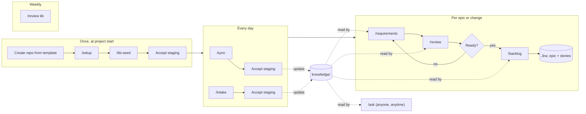

# Which command to run, and when

The eight commands fall into four rhythms: once at the start, every day, once per epic, and weekly.
`/ask` can be used at any time by anyone. This note is the source for the handbook's "what do I run
now?" page.

## The whole flow

## Once, at project start (Lead BA)

| Step | Run | Result |
|---|---|---|
| 1 | Create the project BA repository from the template (`SETUP.md`, step 1) | A repository with the harness files and an empty knowledge base |
| 2 | `/mcp`, then sign in to Atlassian in the browser | Jira (and Confluence) reachable |
| 3 | `/setup` | `PROJECT-PROFILE.md` filled, Jira fields known, stakeholders drafted |
| 4 | Drop existing documents into `inbox/`, then `/kb-seed` | Staging files with the first glossary, capabilities, rules, questions |
| 5 | Work through the staging files | The first confirmed knowledge base, committed and pushed |
| 6 | Tell the team to clone the repository | Everyone can `/ask`; their copy updates itself |

## Every day (BA)

| Moment | Run | Why |
|---|---|---|
| Start of the day | Open Claude Code in the repository (the knowledge base pulls itself), then `/sync` | Picks up answers, decisions and changes from Jira and Confluence since yesterday |
| After a meeting or workshop | Save the notes or transcript to `inbox/`, then `/intake inbox/<file>` | Decisions, questions and requirements captured while fresh, with a play-back message for participants |
| A document or email arrives | `/intake inbox/<file>`, or paste the text after `/intake` | The same, for documents |
| A stakeholder answers a question | `/intake` with the answer | Closes the `Q-` item and updates the pages it affects |
| End of a working session in Claude | `/intake` (no argument) | Captures what was worked out in the conversation |
| Someone asks you something | `/ask <question>` | A cited answer, and an open question if the knowledge base doesn't know |

Every `/intake` and `/sync` ends the same way: you accept, edit or reject each staged item, then the
command commits and asks before pushing. Don't leave staging files overnight. `/review kb` lists any
that are older than a day.

## Per epic or change (BA)

| Step | Run | Moves on when |
|---|---|---|
| 1 | `/sync` and `/intake` anything outstanding for the area | The knowledge base is current for this area |
| 2 | `/requirements <epic or topic>` | The document exists and its clarification questions are answered or logged |
| 3 | `/review requirements/<epic>/requirement.md` | Verdict is ready, or you accept the remaining findings |
| 4 | Fix and repeat 2 and 3 as needed | The review verdict changes to ready |
| 5 | `/backlog requirements/<epic>/requirement.md` | Epic and stories created in Jira, keys written back |
| 6 | Developers pick up the Jira keys (the Dev harness's `/ba` reads them) | Handed over |

## Weekly (BA)

| Run | Why |
|---|---|
| `/review kb` | Broken links, old drafts, overdue questions, contradictions; regenerates the index |
| Go through `knowledge/open-questions.md` | Plan who to ask; overdue questions go into the next stakeholder meeting |

## Anyone, anytime

| Who | Run | Notes |
|---|---|---|
| Developer, tester, product owner, new BA | `/ask <question>` | Read-only. Draft answers are marked "unconfirmed". If the knowledge base doesn't know, it drafts a question to send to the BA |
| A teammate with material for the knowledge base | Send it to the BA, or run `/intake` and open a pull request with the staging file | The BA accepts or rejects; nothing changes until then |

## "What do I run?" in one table

| Situation | Command |
|---|---|
| New project | `/setup`, then `/kb-seed` |
| New notes, transcript, document or email | `/intake <file>` |
| Something got decided in Jira or Confluence | `/sync` |
| I worked something out with Claude | `/intake` |
| Need requirements for an epic | `/requirements <epic>` |
| Is this ready for the backlog? | `/review <document>` |
| Put it in Jira | `/backlog <document>` |
| Is someone else's ticket any good? | `/review <JIRA-KEY>` |
| How does X work? / What did we decide about Y? | `/ask` |
| Is the knowledge base healthy? | `/review kb` |

## What not to do

- Don't edit the generated files (`index.md`, the registers) by hand. `/review kb` rebuilds them.
- Don't paste raw notes straight into knowledge pages. Use `/intake`, so sources and conflicts are
  checked.
- Don't create Jira issues by hand for work that has a requirement document. Use `/backlog`, so
  traceability and duplicate checks happen.
- Don't commit anything in `inbox/`. It is gitignored for a reason.
