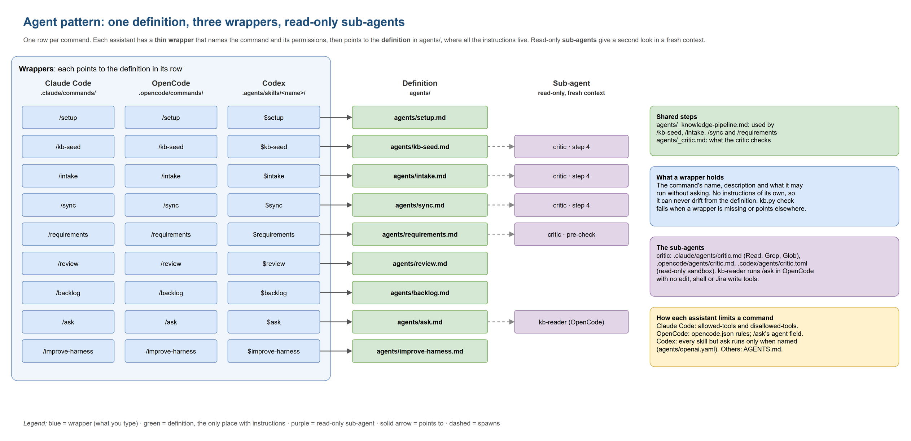
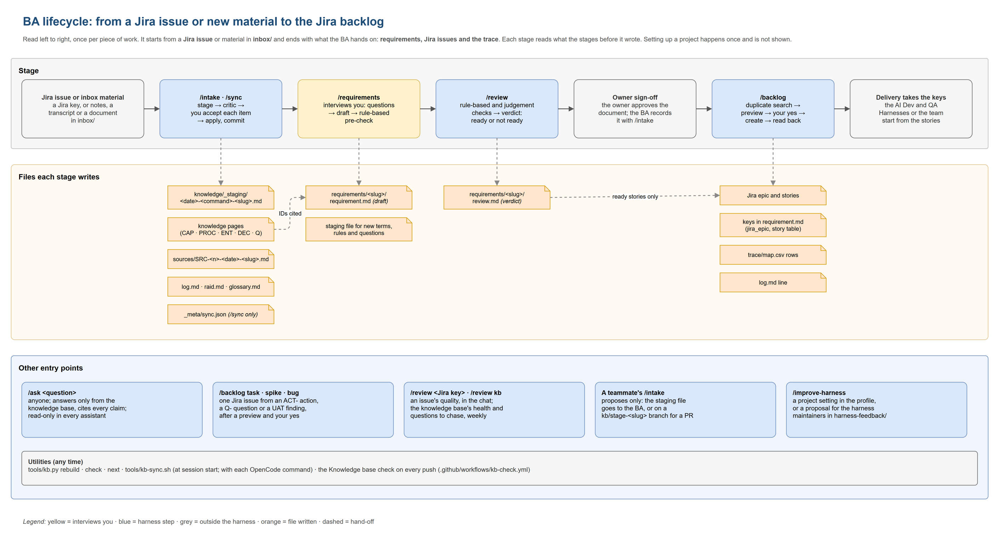
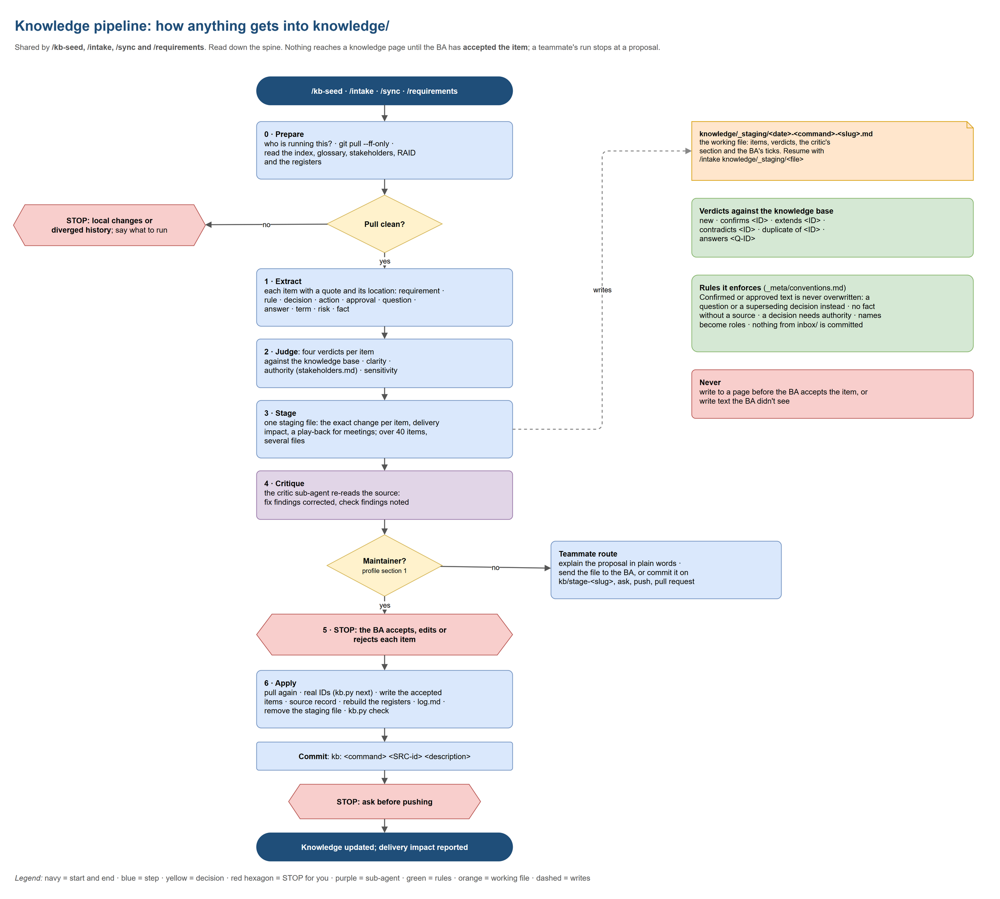
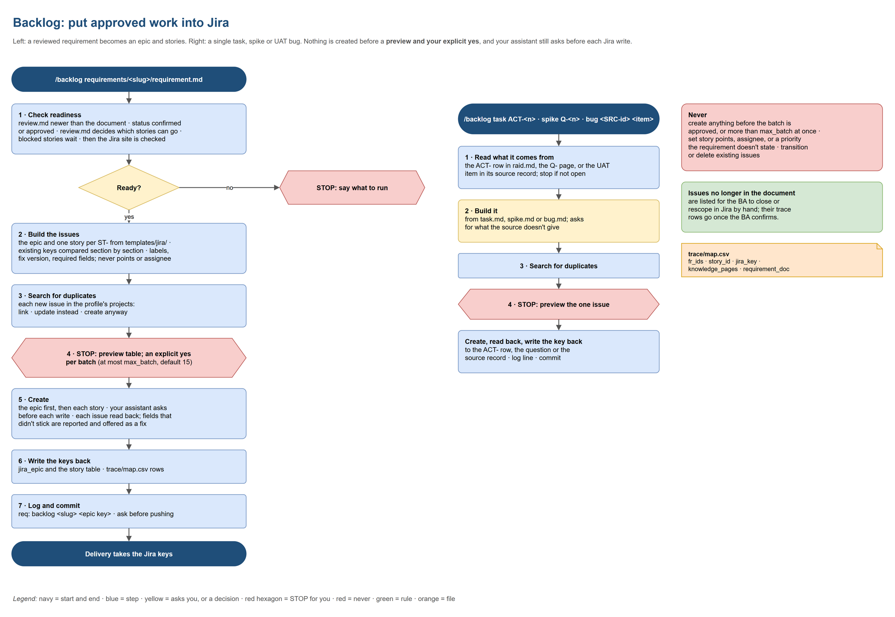
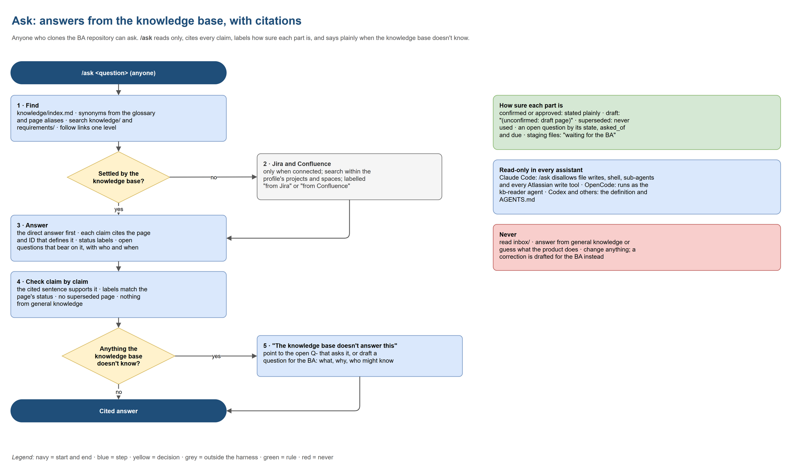
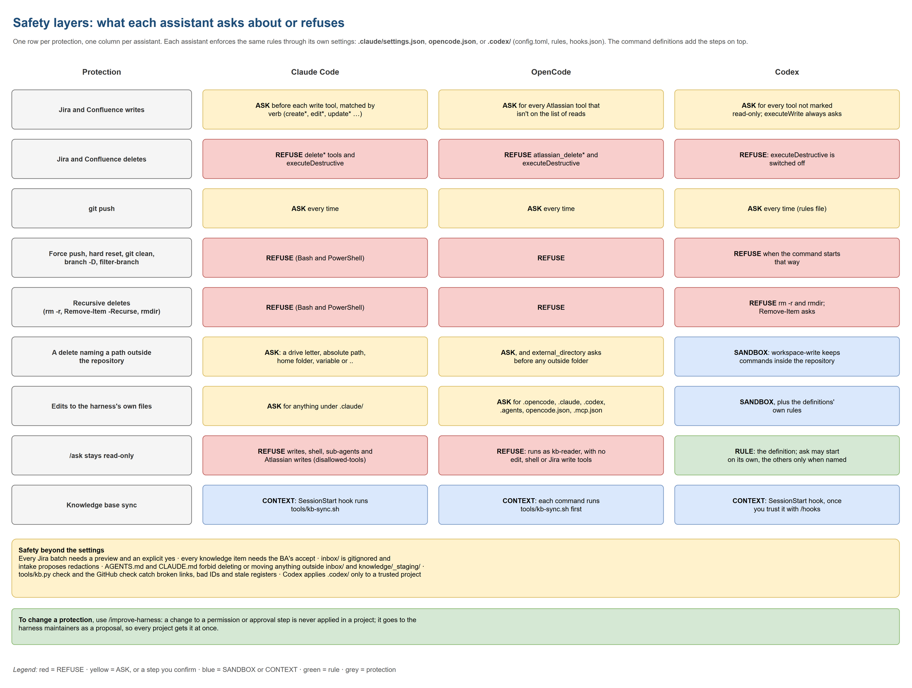
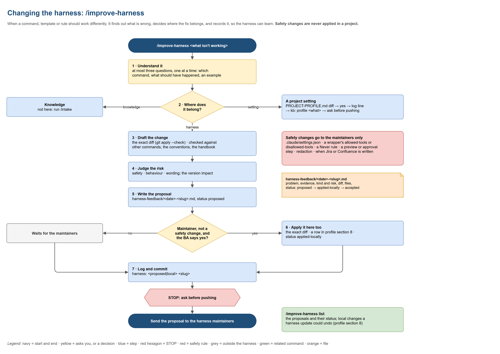

# How the AI BA Harness works

The AI BA Harness gives business analysts a way of working with an AI assistant on one project's
knowledge. It has nine commands, a knowledge base kept as plain Markdown, fixed steps that stop for
the BA's decision before anything is stored or sent to Jira, and safety settings for each assistant
it runs in: Claude Code, OpenCode and Codex. Each part of the system has a diagram below.

The guide is for business analysts who run the commands, teammates who ask the knowledge base
questions, and whoever maintains the harness. The command definitions live in
[`project/agents/`](../../project/agents/README.md), the knowledge base rules in
[`project/knowledge/_meta/conventions.md`](../../project/knowledge/_meta/conventions.md), and the
setup steps in [`SETUP.md`](../../SETUP.md). The BA handbook, [`../index.html`](../index.html), has a
worked example of every command; this guide shows how the pieces fit together. All the diagrams come
from one multi-page draw.io file,
[`diagrams/ai-ba-harness/ai-ba-harness.drawio`](diagrams/ai-ba-harness/ai-ba-harness.drawio) (see
[Updating the diagrams](#updating-the-diagrams)).

## Contents

1. [Architecture: definitions, wiring and knowledge](#1-architecture-definitions-wiring-and-knowledge)
2. [Agent pattern: one definition, three wrappers](#2-agent-pattern-one-definition-three-wrappers)
3. [The BA lifecycle](#3-the-ba-lifecycle)
4. [The knowledge pipeline](#4-the-knowledge-pipeline)
5. [Requirements and review (`/requirements`, `/review`)](#5-requirements-and-review-requirements-review)
6. [Backlog (`/backlog`)](#6-backlog-backlog)
7. [Ask (`/ask`)](#7-ask-ask)
8. [Safety layers](#8-safety-layers)
9. [Changing the harness (`/improve-harness`)](#9-changing-the-harness-improve-harness)
10. [Concepts that apply everywhere](#10-concepts-that-apply-everywhere)
11. [A BA's day and week](#11-a-bas-day-and-week)
12. [Which command do I use?](#12-which-command-do-i-use)
13. [Updating the diagrams](#updating-the-diagrams)

## 1. Architecture: definitions, wiring and knowledge


A project gets its own BA repository, created from this template with `scripts/new-project.sh`.
Everything in that repository comes from [`project/`](../../project/README.md). You open your
assistant in the repository and type a command. The assistant's wiring finds the command and points
it at its definition in `agents/`, which holds all the instructions. The definition reads the
knowledge base, stages changes for you to accept, writes what you accept, and runs the tools.

| Part | Folder or file | Holds | Who runs it |
|---|---|---|---|
| Command definitions | `agents/` | The nine commands, the shared knowledge pipeline and the critic, in plain Markdown | Read by the assistant; the only place with instructions |
| Wiring for each assistant | `.claude/`, `.opencode/` and `opencode.json`, `.agents/skills/` and `.codex/` | The thin wrappers, the read-only sub-agents and each assistant's safety settings | Each assistant loads its own |
| Project knowledge | `knowledge/`, `requirements/`, `trace/`, `PROJECT-PROFILE.md`, `templates/`, `harness-feedback/` | What the project knows, the requirement documents, the trace from requirement to Jira, the project's settings | Written only through the commands, after your accept |
| Tools | `tools/`, `.github/workflows/` | The knowledge base tool, the sync script and the check that runs on every push | The commands, the session start, and the git host |
| Root files | `CLAUDE.md`, `AGENTS.md`, `.mcp.json`, `HARNESS_VERSION` | Guidance for Claude Code and for every other assistant, the Atlassian server, the template version | Loaded into each session |

The project knowledge:

| Path | Purpose |
|---|---|
| [`knowledge/`](../../project/knowledge/README.md) | Pages for capabilities, processes, entities, decisions and questions; the glossary, stakeholders, RAID log and change log; the generated index and registers |
| `knowledge/_staging/` | Proposed changes waiting for the BA's decision, one file per input |
| `knowledge/sources/` | One source record per input: a redacted summary, what it changed, what was rejected and why |
| [`knowledge/_meta/`](../../project/knowledge/_meta/conventions.md) | The conventions every command follows, the page templates, and `sync.json`, the place `/sync` reached |
| `requirements/<slug>/` | `requirement.md`, written by `/requirements`, and `review.md`, written by `/review` |
| [`trace/map.csv`](../../project/trace/map.csv) | One row per story: its requirements, Jira key, knowledge pages and requirement document |
| [`PROJECT-PROFILE.md`](../../project/PROJECT-PROFILE.md) | Eight sections: project and maintainers, Atlassian, Jira conventions, business areas, settings, material for `/kb-seed`, writing rules, local harness changes |
| [`templates/`](../../project/templates) | The requirement document, the five Jira issue types (epic, story, task, spike, bug) and the harness feedback proposal |
| `harness-feedback/` | Proposals for the harness maintainers, written by `/improve-harness` |
| `inbox/` | Raw notes, transcripts and documents. Git ignores everything in it, so nothing raw is ever committed |

The wiring for each assistant:

| Assistant | Commands | Read-only sub-agents | Settings |
|---|---|---|---|
| Claude Code | [`.claude/commands/`](../../project/.claude/commands), run as `/intake` | [`.claude/agents/critic.md`](../../project/.claude/agents/critic.md) | [`.claude/settings.json`](../../project/.claude/settings.json), `.mcp.json`, `CLAUDE.md` |
| OpenCode | [`.opencode/commands/`](../../project/.opencode/commands), run as `/intake` | [`.opencode/agents/`](../../project/.opencode/agents): `critic.md` and `kb-reader.md` | [`opencode.json`](../../project/opencode.json), `AGENTS.md` |
| Codex | [`.agents/skills/`](../../project/.agents/skills), run as `$intake` | [`.codex/agents/critic.toml`](../../project/.codex/agents/critic.toml) | [`.codex/config.toml`](../../project/.codex/config.toml), [`.codex/rules/`](../../project/.codex/rules), [`.codex/hooks.json`](../../project/.codex/hooks.json), `AGENTS.md` |
| Any other | None; you ask it to "run intake" by name | None | [`AGENTS.md`](../../project/AGENTS.md) |

Jira and Confluence are reached through the Atlassian MCP server
(`https://mcp.atlassian.com/v2/mcp`), signed in as you with OAuth: `/mcp` in Claude Code,
`opencode mcp auth atlassian` in OpenCode, `codex mcp login atlassian` in Codex. No token is stored in
the repository. When the server isn't connected, `/setup` records your answers as "not verified",
`/review` reports the Jira duplicate check as not run, and `/ask` answers from the knowledge base
alone. `/sync` and `/backlog` need the connection and stop without it.

## 2. Agent pattern: one definition, three wrappers



A command is defined once and wired into each assistant:

1. The definition, `agents/<command>.md`, holds every instruction: what to read first, the steps,
   the report and the list of things never to do. It is plain Markdown that any assistant can follow.
2. Each assistant has a wrapper that names the command, gives its description and what it may run
   without asking, and points to the definition. The wrapper carries no instructions of its own, so
   it can't drift from the definition. `python tools/kb.py check` fails when a command has no wrapper
   in an assistant's folder, or when a wrapper points somewhere else.
3. Four commands share [`_knowledge-pipeline.md`](../../project/agents/_knowledge-pipeline.md):
   `/kb-seed`, `/intake`, `/sync` and `/requirements`. All of them put knowledge into the knowledge
   base the same way.
4. The read-only `critic` sub-agent follows [`_critic.md`](../../project/agents/_critic.md). The
   pipeline starts it at step 4 to check each staging file, and `/requirements` starts it for its
   pre-check. When an assistant has no sub-agents, the same checks run as a separate second pass.

How each assistant limits a command:

- In Claude Code, each wrapper's `allowed-tools` pre-approves only the reads and git commands that
  command needs. `/ask` also lists every write, shell, sub-agent and Atlassian write tool under
  `disallowed-tools`. The `critic` sub-agent has only `Read`, `Grep` and `Glob`.
- In OpenCode, `opencode.json` holds the rules for every command. `/ask` runs as the `kb-reader`
  agent, which has no edit, shell, sub-agent or Jira write tools. OpenCode also reads the Codex skills
  in `.agents/skills/`, so `opencode.json` blocks them there and the commands run only as
  `/commands`.
- In Codex, each skill except `ask` has `agents/openai.yaml` set so that it runs only when you name
  it. The `critic` agent runs in a read-only sandbox.
- Any other assistant follows `AGENTS.md`, which lists the commands and the rules to keep where
  nothing enforces them.

## 3. The BA lifecycle



The lifecycle runs once for each piece of work. Setting up a project (`new-project.sh`, `/setup`,
the first `/kb-seed`) happens once and isn't part of it. The standard path:

```text
Jira issue, or notes or a document in inbox/
/intake <inbox file> or /sync    → knowledge/_staging/<date>-<command>-<slug>.md, then the accepted
                                   knowledge pages, sources/SRC-<n>-<date>-<slug>.md, log.md
                                   (and _meta/sync.json for /sync)
/requirements <epic or topic>     → requirements/<slug>/requirement.md (draft), a staging file for
                                   new terms, rules and questions
/review requirements/<slug>/requirement.md
                                  → requirements/<slug>/review.md with the verdict
  … owner sign-off: the owner approves the document; the BA records it with /intake …
/backlog requirements/<slug>/requirement.md
                                  → the Jira epic and stories, the keys in requirement.md,
                                   rows in trace/map.csv, a log.md line
  … delivery: the AI Dev and QA Harnesses, or the team, start from the Jira stories …
```

How the stages connect:

- You decide at every step that changes something. Each item a command proposes waits for your
  accept, edit or reject. `/requirements` asks its questions one at a time and waits for a yes to the
  document. `/backlog` shows a preview and waits for an explicit yes before it creates anything, and
  your assistant asks again before each Jira write.
- `/requirements` starts from what the knowledge base already says and cites its rules, decisions
  and questions by ID. If the knowledge base has nothing on the area, it suggests an `/intake` of
  existing material first.
- `/backlog` takes only the stories `review.md` lists as ready, and needs `review.md` to be newer than
  the document. A sign-off approves the content, not its quality, so it never overrides the review.
- The owner signs off outside the harness. When the sign-off arrives, for example as an email saved
  in `inbox/`, `/intake` records it: the document becomes `approved`, and every proposal it was
  waiting on becomes an answered question and a rule.
- `/backlog` writes each story's Jira key into the document and `trace/map.csv`. When `/sync` later
  sees a traced story reach Done, it proposes bringing what the story delivered into the knowledge
  pages.

There are other ways in. Anyone can run `/ask` to get an answer with citations. `/backlog task`,
`spike` or `bug` turns a single action, question or UAT finding into one Jira issue. `/review` also
takes a Jira key, or `kb` for a weekly health check of the knowledge base. A teammate's `/intake`
proposes but can't decide, and its staging file goes to the BA or onto a `kb/stage-<slug>` branch for
a pull request. `/improve-harness` changes how the harness itself works.

## 4. The knowledge pipeline



The pipeline is [`_knowledge-pipeline.md`](../../project/agents/_knowledge-pipeline.md), and the
rules it enforces are in [`conventions.md`](../../project/knowledge/_meta/conventions.md). `/kb-seed`,
`/intake`, `/sync` and `/requirements` all run it.

When it runs:

- It first asks who is running it, if that isn't clear. Only the maintainers listed in profile
  section 1 apply changes. Anyone else follows the teammate route: the proposal is explained in plain
  words and handed to the BA, or committed on a `kb/stage-<slug>` branch for a pull request.
- It pulls first (`git pull --ff-only`) and stops if that fails, so nothing is staged against an old
  copy.
- Extract takes every item from the input with an exact quote and where it was found: a file and
  bullet, a transcript time, a Jira key and comment number, or a Confluence page and section.
- Judge gives each item four verdicts. Against the knowledge base it is new, confirms, extends,
  contradicts, a duplicate, or answers a question. It also gets a clarity verdict (vague words come
  from profile section 7), an authority verdict from `stakeholders.md` (can this person decide it?)
  and a sensitivity verdict (what to redact).
- Stage writes one file to `knowledge/_staging/` with the exact change for every item, including the
  whole text of any new page. Items that change an existing page also list the requirements, stories
  and Jira keys that rely on it. Meetings get a play-back message the BA can send to the participants.
- The critic re-reads the source and checks the staging file against it and the knowledge base. The
  command corrects what the critic marks `fix` and leaves its `check` findings for you.
- At the STOP you accept, edit or reject each item, by ticking boxes in the file or in the chat. Every
  decision is written into the staging file before anything is applied.
- Apply gives the real IDs (`python tools/kb.py next`), writes exactly what you accepted, writes the
  source record, rebuilds the index and registers, adds a `log.md` line, removes the staging file and
  runs `python tools/kb.py check`. It commits as `kb: <command> <SRC-id> <description>` and asks
  before pushing.
- Confirmed or approved text is never overwritten. A contradiction becomes a question, and a change
  by someone who can decide it becomes a decision that supersedes the old rule.
- To decide later or on another machine, commit the staging file and resume with
  `/intake knowledge/_staging/<file>`. It re-checks what changed in the knowledge base since.

`/sync` feeds the pipeline from Jira and Confluence. It reads what changed since `last_synced` in
`knowledge/_meta/sync.json`, keeps answers, decisions, changes, terms, status changes with business
meaning and delivered work, and moves `last_synced` only after you have decided every item. `/kb-seed`
feeds it from the existing material listed in profile section 6, which it reads in place and never
changes.

## 5. Requirements and review (`/requirements`, `/review`)


The commands are [`requirements.md`](../../project/agents/requirements.md) and
[`review.md`](../../project/agents/review.md), and the document follows
[`templates/requirement.md`](../../project/templates/requirement.md).

When you run `/requirements`:

- It takes an epic name, a topic or a Jira epic key, and starts with a cited summary of what the
  knowledge base says about the area and the open questions that touch it.
- It decides what it can from the knowledge base, states small gaps as assumptions, and asks the rest
  in rounds of at most five questions, one at a time, each with a recommended answer. Scope comes
  first, then rules and permissions, then data, then the user's experience.
- Scope, the story split and the fix version are yours to settle. Product behaviour belongs to
  whoever `stakeholders.md` says can decide it. When that isn't you, your answer becomes a proposal:
  a question to the owner, with the requirement marked "pending Q-x" until the owner's sign-off
  answers them all at once.
- The draft has functional requirements, non-functional requirements in EARS form with a measure,
  user stories with at least two Given/When/Then criteria including a failure or permission path,
  assumptions, open questions and any conflicts with the knowledge base.
- The critic's pre-check runs the rule-based checks from `review.md` and fixes what is mechanical. It
  gives no verdict.
- New terms, rules, assumptions and questions are staged through the pipeline. You say yes or no to
  the document and decide each staged item, and it commits everything once as
  `req: draft <slug>`. A no deletes only the draft this run created.

When you run `/review`:

- It changes nothing but its report. Rule-based checks run first (the story form, two criteria, one
  testable statement per requirement, EARS, vague words, IDs, the fix version, cited IDs that exist),
  then judgement checks (contradictions, glossary use, INVEST, missing paths, likely Jira duplicates,
  UI steps in criteria).
- The verdict is ready when there are no critical or major findings. Either way it lists the stories
  that are ready and the blocked ones with their questions.
- For a document it writes `requirements/<slug>/review.md` and commits it as
  `req: review <slug> <verdict>`. For a Jira key the report stays in the chat. `/review kb` runs
  `tools/kb.py check`, the judgement checks no script can do, a message per role with the questions
  to chase, and a rebuild of the index and registers.
- If the document is ready and still a draft, it asks whether to set it to `confirmed`, the status
  `/backlog` needs.

## 6. Backlog (`/backlog`)



The command is [`backlog.md`](../../project/agents/backlog.md), with the issue templates in
[`templates/jira/`](../../project/templates/jira).

When you run it on a requirement:

- It checks readiness before it touches Jira: `review.md` must be newer than the document, and the
  document must be `confirmed` or `approved`. `review.md` decides which stories can go; stories with a
  blocking question wait.
- It builds the epic and one story per `ST-` from the templates, with the labels, the fix version and
  every field Jira requires. Story points and assignee stay empty, and priority is set only when the
  requirement states one.
- Issues that already have a key are compared section by section, and a change is proposed as a
  diff. A key whose story left the document is never transitioned or deleted; it is listed for you to
  close in Jira by hand.
- It searches Jira for duplicates of each new issue and offers to link, to update the existing issue
  instead, or to create anyway.
- The preview shows every issue with its action and fields, in batches of at most `max_batch`
  (default 15). Nothing is created before your explicit yes for the batch.
- It creates the epic first and then each story, reads every issue back, and reports any field that
  didn't stick with an offer to fix it. Then it writes the keys into the document and
  `trace/map.csv`, adds a `log.md` line and commits as `req: backlog <slug> <epic key>`.

`/backlog task ACT-<n>`, `spike Q-<n>` and `bug <SRC-id> <item>` create one issue from an action in
`raid.md`, an open question, or a UAT finding recorded by `/intake`, after the same duplicate search
and a preview, and write the key back to where it came from.

## 7. Ask (`/ask`)



The command is [`ask.md`](../../project/agents/ask.md). `CLAUDE.md` and `AGENTS.md` tell every
assistant to answer any project question this way, whether or not the person typed `/ask`.

When you ask:

- It starts from `knowledge/index.md`, widens the search with the glossary's other names and page
  aliases, and searches `knowledge/` and `requirements/`. It never reads `inbox/`.
- It reads Jira and Confluence only when the knowledge base doesn't settle the question, or the
  question is about delivery status, and labels what it found there as "from Jira" or "from
  Confluence".
- Every claim cites the page and ID that defines it. Confirmed and approved content is stated
  plainly, draft content is marked "(unconfirmed: draft page)", and superseded content is never used.
- Before answering, it checks each claim against the sentence on the cited page and drops anything
  from general knowledge.
- When the knowledge base doesn't know, it says so and points to the open question that already asks
  it, or drafts one you can send to the BA.

## 8. Safety layers



Each assistant enforces the same protections through its own settings:
[`.claude/settings.json`](../../project/.claude/settings.json) for Claude Code,
[`opencode.json`](../../project/opencode.json) for OpenCode, and
[`.codex/config.toml`](../../project/.codex/config.toml) with
[`.codex/rules/ba-harness.rules`](../../project/.codex/rules/ba-harness.rules) and
[`.codex/hooks.json`](../../project/.codex/hooks.json) for Codex.
[`agents/README.md`](../../project/agents/README.md) explains the layers.

| Protection | Claude Code | OpenCode | Codex |
|---|---|---|---|
| Jira and Confluence writes | Asks before each write tool, matched by verb | Asks for every Atlassian tool that isn't a listed read | Asks for every tool not marked read-only; `executeWrite` always asks |
| Jira and Confluence deletes | Refused | Refused | Refused: `executeDestructive` is switched off |
| `git push` | Asks | Asks | Asks |
| Force push, hard reset, `git clean`, `branch -D`, `filter-branch` | Refused | Refused | Refused when the command starts that way |
| Recursive deletes | Refused | Refused | Refused for `rm -r` and `rmdir`; `Remove-Item` asks |
| A delete naming a path outside the repository | Asks | Asks; `external_directory` asks before any outside folder | The sandbox keeps commands inside the repository |
| Edits to the harness's own files | Asks for `.claude/` | Asks for the harness folders, `opencode.json` and `.mcp.json` | The sandbox, and the definitions' rules |
| `/ask` | Refused writes, shell, sub-agents and Atlassian writes | Runs as `kb-reader`, with no write tools | Follows the definition |
| Knowledge base sync | The SessionStart hook runs `tools/kb-sync.sh` | Each command runs it first | The SessionStart hook, once you trust it with `/hooks` |

The rules match commands as assistants normally write them, so only the narrow git commands each
command needs run without asking, and anything unusual prompts. Codex applies the `.codex/` settings
only to a trusted project.

Other safeguards:

- Every Jira batch needs a preview and an explicit yes, and every knowledge item needs the BA's
  accept.
- `inbox/` is ignored by git, and `/intake` proposes removing names, contact details and other
  personal data before anything is stored.
- `CLAUDE.md` and `AGENTS.md` forbid deleting or moving anything outside `inbox/` and
  `knowledge/_staging/`, recursive deletes, and touching `.git`. When a script or command refuses, the
  assistant stops and asks.
- `python tools/kb.py check`, and the Knowledge base check on every push, catch broken links, bad
  properties, unknown or duplicate IDs, stale registers and missing wrappers.
- `new-project.sh` only adds files, in a new folder.

To change a protection, use `/improve-harness`. A change to a permission or approval step is never
applied in a project; it goes to the harness maintainers.

## 9. Changing the harness (`/improve-harness`)



The command is [`improve-harness.md`](../../project/agents/improve-harness.md):

1. It asks at most three questions, one at a time: which command, what should have happened, and an
   example.
2. It decides where the fix belongs. A project setting goes into `PROJECT-PROFILE.md` after a yes.
   Knowledge goes through `/intake`. Anything else is a harness change.
3. It writes the exact change as a diff and checks it against the other commands, the conventions and
   the handbook.
4. It judges the risk: a safety change, a behaviour change, or a wording change, with the version
   impact.
5. It writes the proposal to `harness-feedback/<date>-<slug>.md` from
   [`templates/harness-feedback.md`](../../project/templates/harness-feedback.md).
6. It applies the change locally only when you maintain the repository, the change isn't a safety
   change, and you say yes. A local change is recorded in profile section 8, so a later harness update
   doesn't silently undo it.
7. It commits as `harness: <proposed|local> <slug>` and asks before pushing. You send the proposal to
   the harness maintainers.

A safety change touches whether, when or with what approval the harness writes anything: the
settings, a wrapper's tool grants, a "Never" rule, a preview or approval step, redaction, or when Jira
or Confluence is written. Those are never applied in a project. `/improve-harness list` shows the
proposals and the local changes a harness update could undo.

For the maintainers, [`SETUP.md`](../../SETUP.md) describes taking a proposal into the template and
updating a project to a new harness version.

## 10. Concepts that apply everywhere

- Pages, rules and terms are `draft`, `confirmed`, `approved` or `superseded`. Confirmed means a BA
  checked the item against its source; approved means someone with authority decided or signed it
  off. Questions have a `state` instead, open or answered. Requirement documents use the same four
  statuses.
- Every item has a stable ID with three digits (`CAP-`, `PROC-`, `ENT-`, `DEC-`, `Q-`, `SRC-`, `BR-`,
  `T-`, the RAID prefixes and `ACT-`), and an ID is never reused. Staging files use provisional IDs
  such as `CAP-new-1`; `python tools/kb.py next` gives the real number when an item is applied.
- Every fact cites the source record it came from. A fact with no source becomes an open question or
  a stated assumption.
- `stakeholders.md` records what each role can decide, with a RACI for recurring decisions. A
  statement from someone who can't decide it is recorded as their view, with a question to the owner.
- `PROJECT-PROFILE.md` holds everything specific to the project: the maintainers, the Jira and
  Confluence settings, the business areas, limits such as `max_batch`, the vague words and preferred
  terms, and local harness changes.
- `tools/kb-sync.sh` only fast-forwards your copy, never overwrites your work, and says what to run
  when it can't. Switch it off with `kb_auto_sync: off` in profile section 5.
- `knowledge/index.md` and the three registers are generated by `python tools/kb.py rebuild` and never
  edited by hand.
- The `knowledge/` folder opens as an Obsidian vault. Links stay in standard Markdown, so the pages
  read the same on GitHub and in any editor.

## 11. A BA's day and week

The commands fall into a daily rhythm, a cycle for each epic, and a weekly check. Set-up happens
once at the start and isn't repeated. In Codex, type `$` in place of `/`.

Every day:

| When | Run | What you get |
|---|---|---|
| At the start of the day | `/sync` | New answers, decisions and changes from Jira and Confluence since the last run, proposed for you to accept |
| After a meeting or workshop | Save the notes or transcript to `inbox/`, then `/intake inbox/<file>` | The decisions, questions and requirements, and a play-back message for the participants |
| When a document or email arrives | `/intake inbox/<file>`, or paste the text after `/intake` | The same, for documents |
| When a stakeholder answers a question or signs off | `/intake` with the answer or the email | The `Q-` item closed and its pages updated; a sign-off sets the requirement to `approved` |
| When an action needs tracking in Jira | `/backlog task ACT-<n>` | One Jira task, linked back to its row in `raid.md` |
| At the end of a working session | `/intake` with no argument | What you worked out in the conversation, captured as proposals |
| When someone asks you something | `/ask <question>` | A cited answer, or a drafted question when the knowledge base doesn't know |

Every `/intake` and `/sync` ends the same way: you accept, edit or reject each staged item, and the
command commits and asks before pushing. Decide staging files the same day; `/review kb` lists any
older than a day.

For each epic or change:

1. Run `/sync`, and `/intake` anything outstanding for the area, so the knowledge base is current.
2. Run `/requirements <epic or topic>`. It interviews you and writes the document, with the epic's fix
   version: a release such as `2.26`, or `unscheduled`.
3. Run `/review requirements/<slug>/requirement.md`. Fix what it finds and review again until the
   verdict is ready, then set the document to `confirmed`. Owner sign-off, when it comes, makes it
   `approved`.
4. Run `/backlog requirements/<slug>/requirement.md`. It creates the epic and one story per `ST-` under
   it, with the fix version, after a duplicate search, a preview and your explicit yes. The fix version
   must already exist in Jira; `/backlog` never creates one.
5. Developers and testers take the Jira keys. Sprints, story points and assignees stay with the team
   in Jira.
6. If the requirement changes, run `/requirements`, `/review` and `/backlog` again. Existing stories
   are updated as a diff, new ones created, and dropped ones listed for you to close by hand.
7. In UAT, `/intake` the session notes, then run `/backlog bug <SRC-id> <item>` for each problem, or
   `/backlog bug <description>` for one you describe yourself. Defects found in testing belong to the
   QA harness.
8. As stories reach Done, `/sync` proposes updating the knowledge pages to match what was delivered.

Every week, run `/review kb`. It reports broken links, old drafts, overdue questions and actions,
leftover staging files, contradictions and business areas with no pages yet, and rebuilds the index
and registers. It also drafts one message per stakeholder with the open questions waiting on them,
for you to send or take to the next meeting.

A task or spike always comes from something recorded first: a task from an `ACT-` action in
`raid.md`, a spike from an open `Q-` question. To raise one that came up in passing, record it with
`/intake` (pasting one line is enough), then run `/backlog task` or `/backlog spike`. Teammates don't
run this cycle. They use `/ask`, and send new material to you.

## 12. Which command do I use?

| I want to… | Claude Code or OpenCode | Codex |
|---|---|---|
| Configure a new BA repository, once | `/setup` | `$setup` |
| Build the first knowledge base from existing material | `/kb-seed` | `$kb-seed` |
| Turn notes, a transcript or a document into proposed knowledge | `/intake inbox/<file>` | `$intake inbox/<file>` |
| Bring new Jira and Confluence activity in | `/sync` | `$sync` |
| Write the requirement document for an epic or topic | `/requirements <epic>` | `$requirements <epic>` |
| Check a document, a Jira issue or the knowledge base | `/review <path, key or kb>` | `$review <path, key or kb>` |
| Put approved stories into Jira | `/backlog requirements/<slug>/requirement.md` | `$backlog requirements/<slug>/requirement.md` |
| Create one Jira task, spike or UAT bug | `/backlog task ACT-<n>` | `$backlog task ACT-<n>` |
| Ask a question about the project | `/ask <question>` | `$ask <question>` |
| Change a setting or propose a harness change | `/improve-harness <problem>` | `$improve-harness <problem>` |

In any other assistant, ask it to run the command by name. The handbook's command reference,
[`../index.html#commands`](../index.html#commands), lists every argument.

## Updating the diagrams

Edit `diagrams/ai-ba-harness/ai-ba-harness.drawio` in the draw.io desktop app, or in VS Code with
the "Draw.io Integration" extension. It is one uncompressed file with a page for each diagram. Then
export each page to its PNG from `docs/harness-docs/diagrams/ai-ba-harness/`:

```bash
# Windows per-user install; a machine-wide install is at "/c/Program Files/draw.io/draw.io.exe".
# macOS: /Applications/draw.io.app/Contents/MacOS/draw.io · Linux: drawio (under xvfb-run if headless)
DRAWIO="$LOCALAPPDATA/Programs/draw.io/draw.io.exe"
names=(01-architecture 02-agent-pattern 03-ba-lifecycle 04-knowledge-pipeline 05-requirements-review
       06-backlog 07-ask 08-safety-layers 09-improve-harness)
for i in "${!names[@]}"; do
  "$DRAWIO" -x -f png -p $((i + 1)) -s 1.5 -b 20 -o "${names[$i]}.png" ai-ba-harness.drawio
done
```

When a harness change adds, renames or removes a command, a wrapper, a safety rule or a workflow
step, update the diagrams and this guide in the same change.

This guide is also published as [`docs/how-it-works.html`](../how-it-works.html), which the handbook
and the README link to. That page is generated from this file, so edit the `.md`, then run
`python scripts/build-harness-guide.py` and commit both files together. `--check` tells you whether
the page is out of date.
