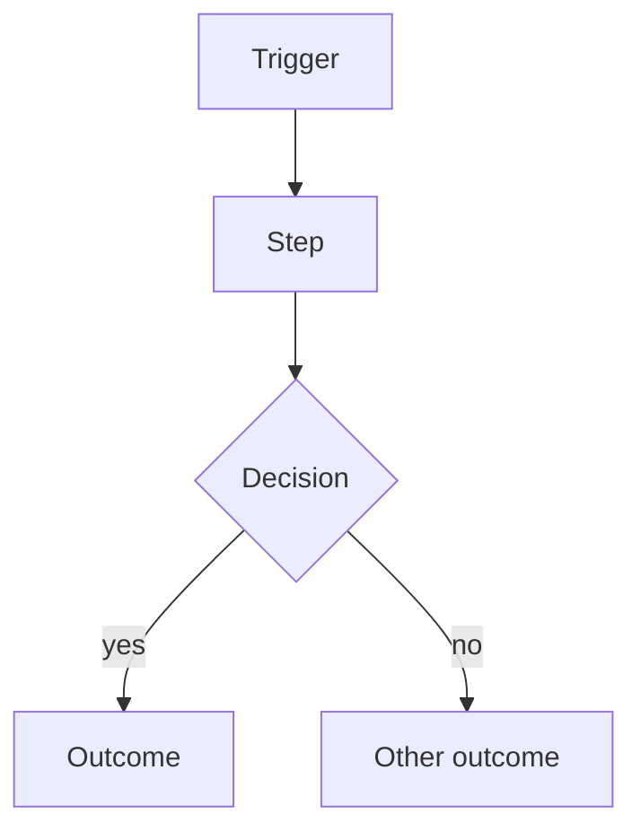

# <Title>

<One sentence: what the process achieves. This sentence is used in the index.>

## Trigger

<What starts it.>

## Actors

| Role | Part they play |
|---|---|

## Steps

1. <Step, with the role that does it.>

## Variations

<Alternative paths and exceptions.>

## Pain points (as-is) or changes (to-be)

<What hurts today, or what the new process changes and why.>

## Rules applied

1. **BR-000** <Rule.> (SRC-000)

## Diagrams for publishing

<Only if needed: `<slug>.as-is.drawio` and `<slug>.as-is.svg` in this folder, exported YYYY-MM-DD.>

## Sources

- SRC-000: <one line>
