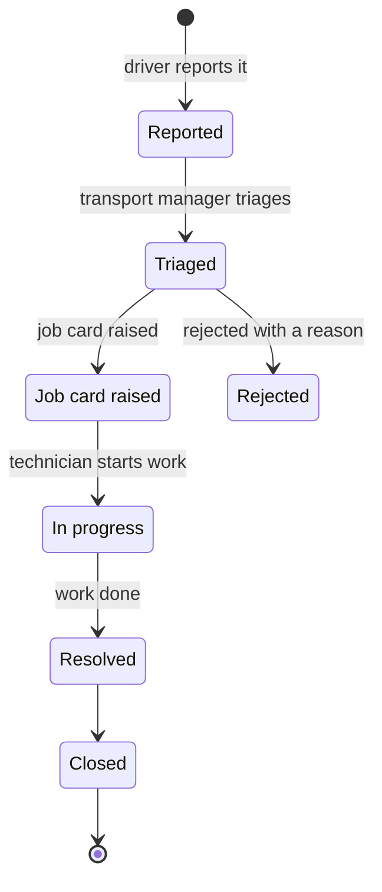

# Defect

A fault on a vehicle, reported by a driver in a walkaround check, that has a category and moves
through a fixed set of states until it is closed or rejected.

## Attributes or permissions

| Name | Meaning | Rules |
|---|---|---|
| Vehicle | The vehicle the fault is on | A defect belongs to one vehicle |
| Category | A (immobilising), B (repair within 48 hours) or C (monitor, repair at next service) | Exactly one ([BR-002](../domains/defects/CAP-001-reporting-a-defect-from-a-walkaround-check.md)) |
| State | Where the defect is in its lifecycle | States in order, none skipped ([BR-005](../domains/defects/CAP-002-triaging-a-defect.md)) |
| Description and photo | What the driver saw | Photo optional; visible only inside the operator's own account |
| Reported by and at | The driver and the time of the report | Starts the escalation clock ([BR-017](../domains/defects/CAP-004-escalating-unactioned-defects.md)) |
| Rejection reason | Why the transport manager rejected it | Required to reject (BR-006) |
| Job card | The job card that fixes it, once raised | All defects on one job card are at the same depot ([BR-009](../domains/workshop/CAP-005-closing-a-job-card.md)) |

## Lifecycle

- No state may be skipped, and Closed is final (BR-005).
- Rejected is reached only from Triaged, with a reason (BR-006).
- While a category-A or category-B defect is in Reported or Triaged it can escalate (BR-015,
  BR-016).

## Where it appears

- [Reporting a defect from a walkaround check](../domains/defects/CAP-001-reporting-a-defect-from-a-walkaround-check.md)
- [Triaging a defect](../domains/defects/CAP-002-triaging-a-defect.md)
- [Escalating unactioned defects](../domains/defects/CAP-004-escalating-unactioned-defects.md)
- [Closing a job card](../domains/workshop/CAP-005-closing-a-job-card.md)
- [From defect report to return to service](../processes/defects/defect-to-return-to-service/PROC-001-defect-to-return-to-service.md)

## Open items

> [!CAUTION]
> **Unresolved:** a job card can close with a defect "deferred with a reason", but the lifecycle has
> no deferred state. See [Q-004](../questions/Q-004-state-of-a-deferred-defect.md).

## Sources

- [SRC-001](../sources/SRC-001-2026-09-16-discovery-workshop.md): Discovery workshop, 2026-09-16: categories, states, rejection
- [SRC-003](../sources/SRC-003-2026-10-06-jira-sync.md): Jira activity to 2026-10-06: who triages (BR-014)
- [SRC-004](../sources/SRC-004-2026-10-09-escalation-requirements-session.md): Requirements session, 2026-10-09: the deferred-state gap
