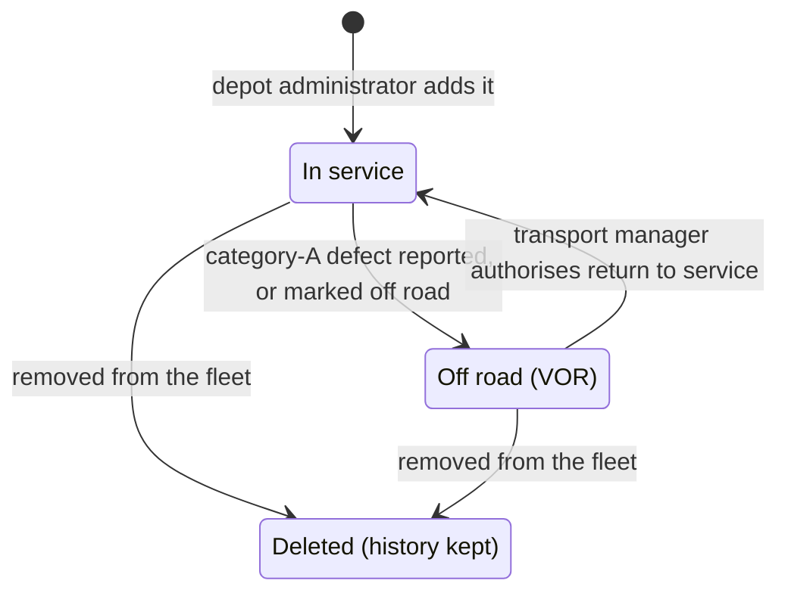

# Vehicle

A goods vehicle, coach or van in an operator's fleet, with its depot, its inspection schedule and
whether it may be driven.

## Attributes or permissions

| Name | Meaning | Rules |
|---|---|---|
| Registration | The vehicle's registration mark | Not to be written in logs or source records |
| Depot | The depot the vehicle belongs to | Decides who can see it and where its job cards are worked |
| Assigned drivers | The drivers who may check it and report its defects | See [BR-004](../domains/defects/CAP-001-reporting-a-defect-from-a-walkaround-check.md) |
| Inspection frequency | Weeks between statutory inspections | One of the presets 4, 6, 8, 10 or 13 weeks; custom values are an open topic for the inspections area |
| Anchor date | The date the schedule is counted from | Due dates are counted forward from it, never from the date an inspection was done; finishing early doesn't move the next due date unless a transport manager re-anchors it, with a reason |
| Compliance band | Red, amber or green, from the nearest due date | Worked out, never stored: green more than 14 days to due, amber 14 days or fewer, red past due |
| VOR | Whether the vehicle is off the road | Set by a category-A defect (BR-003); cleared only by [return to service](../domains/vehicles/CAP-006-authorising-return-to-service.md) |

## Lifecycle

- A VOR vehicle keeps building up due dates but is left out of red-band alerts.
- Deleting a vehicle removes it from the fleet but keeps its whole history.

## Where it appears

- [Reporting a defect from a walkaround check](../domains/defects/CAP-001-reporting-a-defect-from-a-walkaround-check.md)
- [Authorising return to service](../domains/vehicles/CAP-006-authorising-return-to-service.md)
- [From defect report to return to service](../processes/defects/defect-to-return-to-service/PROC-001-defect-to-return-to-service.md)

## Open items

None. Kept as draft until the inspections area has its own pages and these rules are checked
against them.

## Sources

- [SRC-001](../sources/SRC-001-2026-09-16-discovery-workshop.md): Discovery workshop, 2026-09-16
- [SRC-003](../sources/SRC-003-2026-10-06-jira-sync.md): Jira activity to 2026-10-06: link to return to service
