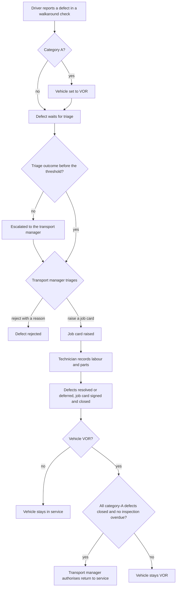

# From defect report to return to service

The process takes a defect from the driver's report, through triage and the workshop, to the vehicle
being safe to drive again, with every step on record.

## Trigger

A driver reports a defect in a walkaround check ([SRC-001](../../../sources/SRC-001-2026-09-16-discovery-workshop.md)).

## Actors

| Role | Part they play |
|---|---|
| Driver | Reports the defect and its category |
| Transport manager | Triages the defect, receives escalations, authorises return to service |
| Workshop technician | Works the job card, records labour and parts, closes and signs it |
| FleetKeep | Sets VOR for category-A defects, checks for escalations every hour, records the audit trail |

## Steps

1. The driver reports the defect in the walkaround check and gives its category
   ([CAP-001](../../../domains/defects/CAP-001-reporting-a-defect-from-a-walkaround-check.md)).
2. FleetKeep sets the vehicle to VOR at once if the defect is category A (BR-003).
3. The transport manager triages the defect: raises a job card or rejects it with a reason
   ([CAP-002](../../../domains/defects/CAP-002-triaging-a-defect.md)).
4. If no triage outcome comes in time, FleetKeep escalates the defect to the transport manager
   ([CAP-004](../../../domains/defects/CAP-004-escalating-unactioned-defects.md)).
5. The workshop technician works the job card, records labour and parts, resolves or defers each
   defect, and signs and closes the job card ([CAP-005](../../../domains/workshop/CAP-005-closing-a-job-card.md)).
6. For a VOR vehicle, the transport manager authorises return to service once every category-A
   defect is closed and no inspection is overdue ([CAP-006](../../../domains/vehicles/CAP-006-authorising-return-to-service.md)).

## Variations

- **Rejected defect:** the process ends at step 3 with the reason recorded.
- **Several defects on one vehicle:** one job card can bundle them, all at the same depot (BR-009).
- **Deferred defect:** a defect can be deferred with a reason when the job card closes; where it goes
  next is unresolved ([Q-004](../../../questions/Q-004-state-of-a-deferred-defect.md)).

## Pain points (as-is) or changes (to-be)

- Escalations reach only the transport manager, by email, and the workshop doesn't see them
  ([R-001](../../../raid.md#risks)). The epic
  [Defect escalation to workshop](../../../../requirements/defect-escalation-to-workshop/requirement.md)
  addresses this.
- A defect reported late in the evening may escalate overnight, when nobody is at the depot
  ([Q-002](../../../questions/Q-002-escalation-clock-outside-working-hours.md)).
- Poor signal at depots can delay the driver's report ([Q-003](../../../questions/Q-003-walkaround-check-without-a-signal.md)).

## Rules applied

1. **BR-012** Every change to a vehicle, walkaround check, defect or job card is recorded in the audit trail with who made it, when, what changed and, where a reason is required, why. (SRC-001)
2. **BR-013** Compliance records are kept for at least 15 months, and deleting a vehicle keeps its history. ([SRC-002](../../../sources/SRC-002-2026-09-23-regulator-roadworthiness-guidance.md))

> [!IMPORTANT]
> BR-013 comes from the regulator's record-keeping expectation (SRC-002). Audit records can't be
> changed or deleted by anyone using FleetKeep.

The steps also apply rules defined on the capability pages: BR-001 to BR-006 and BR-014 to BR-017
(defects), BR-009 to BR-011 (workshop) and BR-018 to BR-020 (vehicles). See
[business-rules.md](../../../business-rules.md).

## Diagrams for publishing

Not needed yet. When this page is published to Confluence, `defect-to-return-to-service.as-is.drawio`
and its exported `.svg` go in this folder.

## Sources

- SRC-001: Discovery workshop on defects, the workshop and return to service, 2026-09-16
- SRC-002: Regulator roadworthiness guidance, summary for FleetKeep, 2026-09-23
- [SRC-003](../../../sources/SRC-003-2026-10-06-jira-sync.md): Jira activity 2026-09-28 to 2026-10-06 (escalation of category-B defects, return-to-service sign-off)
- [SRC-004](../../../sources/SRC-004-2026-10-09-escalation-requirements-session.md): Requirements session, 2026-10-09 (the deferred-defect gap and the epic)
